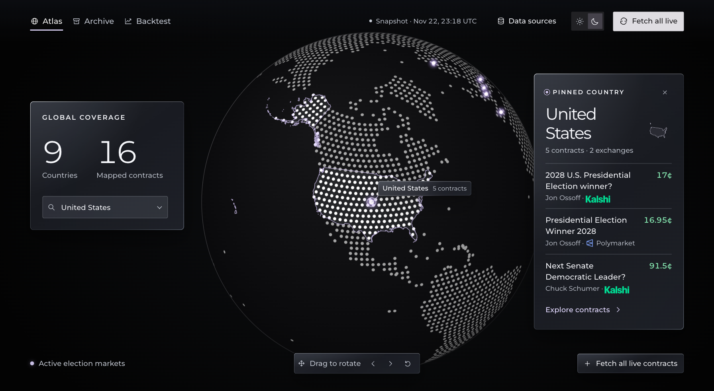
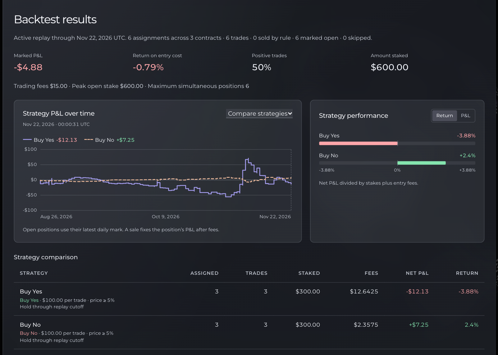

# Election Market Dashboard

Explore election contracts on Kalshi and Polymarket, inspect their price histories, and simulate trading rules in your browser. **No exchange account, wallet or API key is required.**

The dashboard is intentionally simple so anyone can run it and modify it. It uses plain HTML, CSS and JavaScript. To try a change, edit the layout in `index.html` or a strategy rule in `backtest.js`, save the file, and refresh your browser. A small Node.js server handles public data requests from both exchanges.



## Run it locally

1. Download the repository using **Code → Download ZIP** and extract it, or clone it with Git. A private repository requires GitHub access to download.
2. Open a terminal in the extracted folder that contains `index.html` and `server.mjs`. Install a current Node.js LTS release if `node --version` is unavailable. The server uses built-in Node.js modules and fetch, so you can skip package installation and build steps. [Download Node.js](https://nodejs.org/en/download)
3. Start the server and leave the terminal open.

   ```sh
   node server.mjs
   ```

4. Open the [local dashboard](http://127.0.0.1:4173/). Choose **Fetch all live** to replace the opening snapshot with current listings. Press **Ctrl+C** in the terminal when you are finished.

| How you open it | What works |
| --- | --- |
| Double-click `index.html` in the extracted folder | The atlas, bundled market listings and featured price chart load without starting a server. The page tries to fetch exchange data directly. In Chrome, a Polymarket listing request succeeded and the browser blocked a Kalshi listing request under its cross-origin policy. Keep the HTML, scripts, styles and assets together. |
| Run `node server.mjs` and open the local address | The browser and data relay share one origin. This is the supported way to fetch from both exchanges and run backtests using fresh history. Internet access is required for exchange requests. |

The local address works on the computer running the server. To give other people a link, deploy the frontend **and** the Node relay, for example behind an HTTPS reverse proxy that forwards requests to the loopback listener. A static host such as GitHub Pages serves the files but does not execute `server.mjs`. Repository privacy controls who can download the code. A private hosted dashboard also needs access control at the host or proxy.

## Find an election contract

- **Atlas.** Rotate the globe, hover over a mapped country, or use **Find a country**. **Explore contracts** filters the table to that country. The globe counts contracts the app can associate with a country. Explorer also includes contracts with unknown geography.
- **Market explorer.** The asterisk beside the heading explains coverage. Kalshi supplies binary markets from its **Elections** category and Polymarket supplies Yes/No markets tagged **Elections**. A presidential race with five candidates can have five separate contracts on one exchange. A count of 10,000 contracts is a count of market listings, and one election can account for many of them.
- **Fetching.** **Fetch all live** follows the exchanges’ pages and displays matches as they arrive. **Live fetch options** lets you set a maximum, select a venue, search by text, exclude countries, and set settlement bounds. A country exclusion also omits unidentified locations. The progress line distinguishes listings checked from contracts matched. A completed unrestricted fetch across both exchanges is saved in this browser's IndexedDB for the next visit.
- **Sorting and dates.** New searches, filters and refreshes show the highest reported lifetime volumes first across all loaded pages. Kalshi reports contracts traded and Polymarket reports US dollars. The combined table ranks those reported numbers in their original units. Click a column heading for a temporary sort. Settlement filters use inclusive UTC dates. Live markets use an expected date when available. **Undated only** finds rows without a qualifying date.
- **Archive.** Open **Archive** to request historical listings. **Fetch more** appends another batch. Click a row to inspect its outcome, price history, dates and exchange link. A closed listing can appear before the app has a confirmed binary outcome for a settled backtest.

## Strategy comparison

Use this mode to compare entry and exit rules on the same contracts, or assign a different set to each strategy.

1. Open **Backtest → Strategy comparison**. Choose **Settled contracts** for realized payouts or **Active contracts** for a replay through a chosen UTC date.
2. Under **Fetch contracts**, choose the exchange, country, exclusions, text and settlement bounds. The maximum defaults to 500 and is shared across the exchanges. **Election listing** ranks by the parent election’s listing time. **Individual contract listing** ranks each contract by its own creation time. Fetch stops when the requested newest matches are established or the feeds are exhausted. A completed search below the requested count reports how many matched. An interrupted search is labeled partial.
3. Leave **Assign fetched contracts to every strategy** checked to share the selection across existing strategies, or change individual assignments in the picker. The picker orders the selected market universe by lifetime volume. Volume affects the display order only.
4. For each strategy choose **Yes** or **No**, a fixed dollar stake, and entry conditions. Combine conditions with **all** or **any**. Rules include price thresholds, crossings and daily changes. Optional exit conditions also support gains and losses in percentage points from the actual entry price.
5. Select **Run all strategies**. History is fetched once per distinct contract for that run. Each strategy can enter a contract once using up to 90 days of observations before settlement or the active replay cutoff. Without a filled exit, a settled position receives its payout and a live position is valued at the latest eligible mark. Use the chart selector for the portfolio total, overlaid strategies or one strategy. The trade records and skip reasons explain the totals.



In this replay, each strategy staked $100 per contract on the same three Polymarket contracts for the 2028 U.S. presidential election. All six positions were still open on November 22, 2026, so the chart values them at their last observed prices.

## Time-frame trading

Use this mode for repeated buys and sells during a specific period.

1. Set **From** and **Through** to a window of at least three completed UTC days. Choose a moving-average length and, optionally, a minimum consecutive history length. Leaving the minimum blank requires a tradable close for every day of the window and enough prior closes to calculate the first average.
2. Set market status, exchange, country, search text and sample size. Choose **Random sample** or **Choose specific contracts**. The app reads recent election listings, checks whether their trading dates could cover the window, then verifies actual price history for up to 500 candidates. Random mode shuffles within each fetched batch. Manual mode checks each batch in descending volume order. The picker reports the longest qualifying stretch. A smaller result can mean the candidate budget was reached or the feed ran out of eligible history.
3. Set a buy rule and a sell rule for each strategy. Compare the selected side's price to a fixed level, its trailing average, or the previous daily close. You can also restrict entry dates. **Plot prices & averages** shows the Yes and No series before a run.
4. Select **Run trading backtest** to see the performance charts and trade ledger. A strategy can buy the same contract again after selling. At the end of the window, choose to mark the remaining position or sell at a tradable final-day price.

**Example.** Suppose the previous seven Yes closes average 42%. A buy rule set to **5 percentage points below the moving average** signals at 37% or lower. If the next UTC day closes at 40¢, a $40 stake buys 100 shares at 40¢. If a later sell signal fills at 60¢, proceeds are $60 and gross profit is $20.

## Prices, fees and returns

Signals use the last observed price for a UTC day. A signal fills at the next consecutive UTC day’s observed close, strictly between 0% and 100%. Missing observations can prevent a fill. The time-frame average uses the preceding consecutive closes and resets after a gap. Kalshi time-frame history uses daily candles with trades. Polymarket time-frame history takes the last available hourly observation for each UTC date. The app estimates the price of **No** as one minus the price of **Yes**.

| Quantity | Model |
| --- | --- |
| Shares bought | Dollar stake divided by entry price in dollars. Fractional shares are allowed. |
| Net profit | Sale proceeds, settlement payout or marked value, less the stake and trading fees. A winning share settles at $1 and a losing share at $0. |
| Return | `total net profit / (total entry stakes + total entry fees)`. A contract held by two strategies counts as two positions. |
| Estimated fee per buy or sale | For `C` shares at price `p` in dollars, the base calculation is `rate × C × p × (1 − p)`. Settlement payouts and open-position marks carry no exit fee. |

Kalshi uses a modeled rate of `0.07 × multiplier`, with event or series metadata when available and a default multiplier of 1. The model rounds cash debits up and sale credits down to $0.0001 and honors reported waivers. Polymarket uses the reported fee rate, falling back to 0.05 for election markets, rounds the estimate to five decimal places, and charges zero on fee-disabled markets. In the example above, the standard Kalshi fee is $1.68 on each fill, leaving **$16.64 net profit** on $41.68 of entry cost. The fee switch lets you compare gross and net results. [Kalshi fee schedule](https://kalshi.com/docs/kalshi-fee-schedule.pdf) · [Polymarket fees](https://docs.polymarket.com/trading/fees)

The replay assumes independent fixed stakes, unlimited funding and execution at observed closes. Spreads, slippage, order-book depth, rebates, compounding and historical fee-schedule changes are outside the model. Today’s listing membership, volume and history-coverage filters can favor markets that survived or traded more frequently. An active market’s marked profit can change before sale or settlement.

## How a request reaches the exchange

1. `app.js` draws the starting view from the bundled snapshots or the browser’s last complete live catalog. Fetching, opening the archive, inspecting a contract, or running a replay requests additional data as needed.
2. `discovery.js` coordinates pagination, deduplication, restrictions, progress and cancellation. `kalshi.js` reads election series, events, market details and price candles. `polymarket.js` uses Gamma for listings, the Data API for resolution information and the CLOB price-history endpoint for observations. [Kalshi market data](https://docs.kalshi.com/getting_started/quick_start_market_data) · [Polymarket market data](https://docs.polymarket.com/market-data/overview)
3. When Node serves the page, `api.js` sends reads to `/api/fetch` on the same host. `server.mjs` forwards requests to an allowlist of public exchange hosts and paths and returns JSON. Opening the HTML file directly selects the browser-to-exchange path.
4. `backtest.js` and `trading.js` calculate positions, fees and performance in the browser. Chart and UI files render the results. The globe uses bundled Natural Earth geometry and the interface uses bundled Montserrat fonts. [Natural Earth](https://www.naturalearthdata.com/downloads/50m-cultural-vectors/50m-admin-0-countries-2/) · [Montserrat license](montserrat-license.txt)

## Troubleshooting and checks

| Symptom | What to check |
| --- | --- |
| The dashboard opens but Kalshi fetches fail | Start `node server.mjs` and use the HTTP address printed in the terminal. Also check the internet connection and the status shown for the exchange. |
| Port 4173 is busy | On macOS or Linux run `PORT=4174 node server.mjs`. In PowerShell set `$env:PORT = "4174"` before running `node server.mjs`. Open the new address printed by the server. |
| A refresh reports partial results | A source request failed or reached a rate limit. The status names the affected exchange. Retry after a pause or narrow the request. |
| A replay returns no trades | Check the qualifying history, settlement or replay date, entry rules and next-day fill. A time-frame contract may span the dates but have too few observed trading days for the requested average and minimum. |

Run `node --test` from the repository root to check the simulation against fixed price histories. These tests cover entry and exit timing, fees and returns, re-entry, missing days and moving-average coverage. They run offline.
